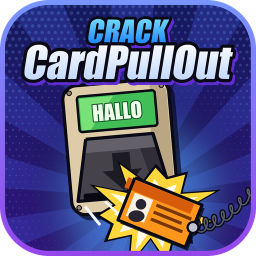
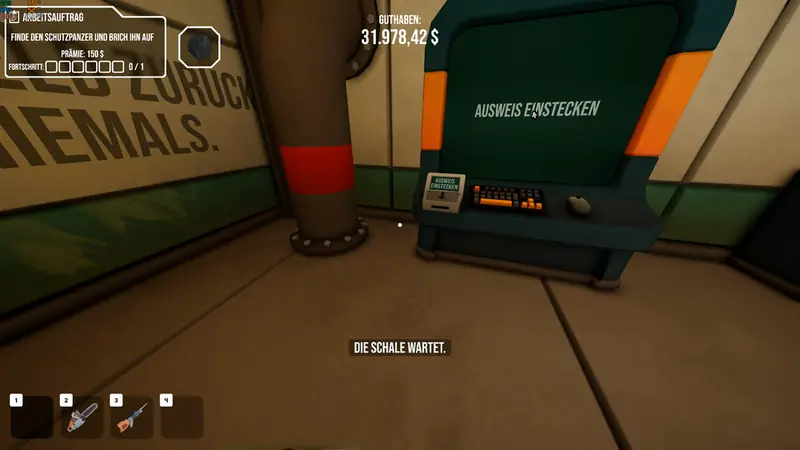
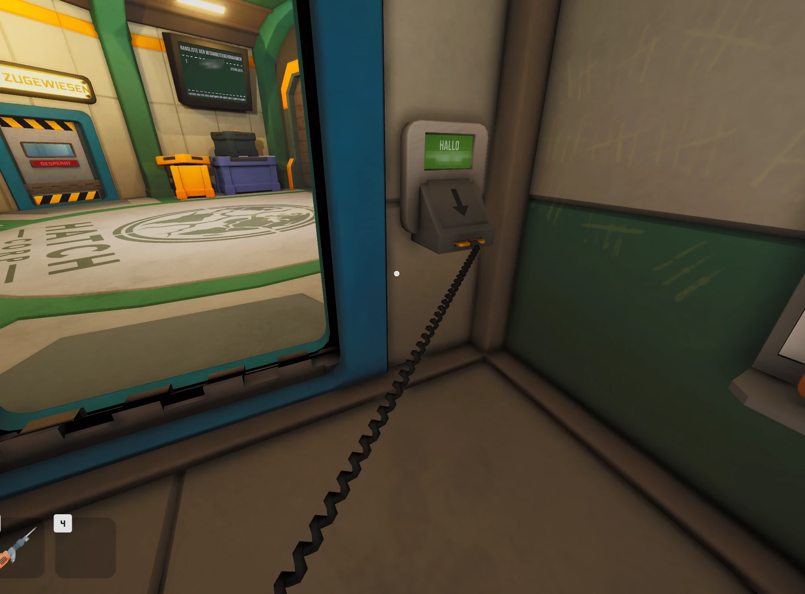
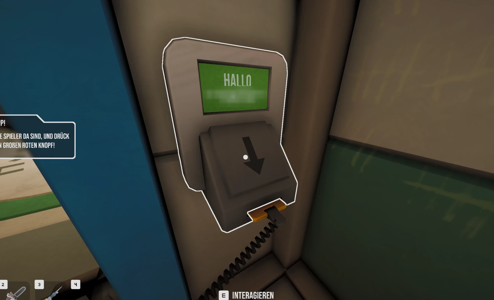

<div align="center">



# CardPullOut

**Walk away and the cable pulls your badge out: a CRACK mod**

[](https://github.com/Yukitus86/CRACK-CardPullOut/releases/latest)
[](https://github.com/Yukitus86/CRACK-CardPullOut/releases)
[](https://github.com/BepInEx/BepInEx/releases)
[](#faq)
[](LICENSE)

[**Download**](https://github.com/Yukitus86/CRACK-CardPullOut/releases/latest) ·
[Installation](#installation) ·
[Configuration](#configuration) ·
[Troubleshooting](#troubleshooting) ·
[Report a bug](https://github.com/Yukitus86/CRACK-CardPullOut/issues/new)



</div>

---

In vanilla CRACK your ID badge stays in the badge reader until you walk back and press **E**. The coiled cable just
holds you in place. **CardPullOut** makes the cable behave like a real one: walk away, the cable goes taut, and the badge
pops out of the reader and snaps back to your pocket.

<p align="center">
  
</p>

## Features

| | |
|---|---|
| 🔌 **Realistic cable** | Walk away from a reader and the badge comes out on its own. No more running back to press **E** |
| 🏃 **No rubber band** | The cable stops holding you back the moment the badge pops out |
| 🌐 **Multiplayer-safe** | Uses the game's own "take badge" request. Works as host or client, and others don't need the mod |
| ⚙️ **Configurable** | Tune how hard you have to pull, or switch the mod off |
| 🧹 **Clean uninstall** | Delete one DLL and the game is vanilla again |

## Installation

### 1. Install BepInEx 5 (once)

CardPullOut is a [BepInEx](https://github.com/BepInEx/BepInEx) plugin. Skip this step if BepInEx is already installed.

1. **Download** `BepInEx_win_x64_5.4.23.x.zip` from the
   [BepInEx releases](https://github.com/BepInEx/BepInEx/releases). Use **BepInEx 5** and **win_x64**, not BepInEx 6.
2. **Open the game folder.** In Steam, right-click **CRACK**, then choose **Manage** → **Browse local files**.
3. **Extract** the zip into that folder, so `winhttp.dll` ends up next to `CRACK.exe`.
4. **Start the game once** and quit at the main menu. BepInEx creates its folders.

### 2. Install CardPullOut

1. **Download** `CardPullOut-CRACK-vX.Y.Z.zip` from the
   [latest release](https://github.com/Yukitus86/CRACK-CardPullOut/releases/latest).
2. **Extract** it into the game folder. It already contains the right folders:

   ```text
   CRACK\
   ├── CRACK.exe
   ├── winhttp.dll                 ◄ BepInEx
   ├── doorstop_config.ini         ◄ BepInEx
   └── BepInEx\
       └── plugins\
           └── CardPullOut.dll     ◄ this mod
   ```

3. **Start the game** through Steam as usual.

> [!TIP]
> Default game folder: `C:\Program Files (x86)\Steam\steamapps\common\CRACK`

### Verify

Open `CRACK\BepInEx\LogOutput.log` after starting the game. It should contain:

```text
[Info   :CardPullOut] CardPullOut 1.0.0 loaded.
```

Then put your badge into any reader and walk away. About 5 m away, the badge pops out.



### Uninstall

Delete `CRACK\BepInEx\plugins\CardPullOut.dll`. To remove BepInEx as well, delete `winhttp.dll`,
`doorstop_config.ini`, `.doorstop_version`, `changelog.txt` and the `BepInEx` folder.

## Configuration

`CRACK\BepInEx\config\yukitus.crack.cardpullout.cfg` is created on the first start. Edit it while the game is closed.

| Setting | Default | Description |
|---|:---:|---|
| `Enabled` | `true` | Turns the mod on or off. |
| `PullMargin` | `0.2` | Meters you have to stretch the cable past its length (5 m) before the badge pops out. Smaller = sooner. |
| `TautTime` | `0.15` | The badge also pops out once the cable has been taut for this many seconds. `0` = the instant it goes taut. |
| `ReleaseImmediately` | `true` | The cable stops holding you back the moment the badge pops out. |
| `LogEjects` | `false` | Writes a line to the BepInEx log every time the badge is pulled out. |

## Compatibility

| | |
|---|---|
| Game build | Steam release, Unity `6000.3.9f1` (Mono) |
| Mod loader | BepInEx `5.4.23.x` win_x64 |
| Platform | Windows 10 / 11 x64 |
| Multiplayer | Client-side only. Each player who wants it installs it for themselves |

## Troubleshooting

<details>
<summary><b>No <code>LogOutput.log</code>, or no "CardPullOut loaded" line</b></summary>

- Make sure `winhttp.dll` is directly next to `CRACK.exe`, not in a subfolder.
- Make sure you installed **BepInEx 5 win_x64**. BepInEx 6 and the x86 version don't work.
- Make sure the DLL is at `BepInEx\plugins\CardPullOut.dll`, not `BepInEx\plugins\BepInEx\plugins\...`.

</details>

<details>
<summary><b>The badge pops out too early or too late</b></summary>

Raise or lower `PullMargin` and `TautTime` in the config file. For example, `TautTime = 0.5` gives you half a second of
taut cable before the badge comes out.

</details>

<details>
<summary><b>It stopped working after a game update</b></summary>

Open an [issue](https://github.com/Yukitus86/CRACK-CardPullOut/issues/new) and attach your
`BepInEx\LogOutput.log`.

</details>

## FAQ

**Can I get banned?**
The mod only changes what your own client does with your own badge. It sends the same "take badge" request as pressing
**E**. CRACK has no anti-cheat as far as we know. As with any mod, use it at your own risk.

**Do my friends need it too?**
No. It works when you're the host and when you're a client. Players without the mod keep the vanilla behavior.

**Doesn't the game already eject the badge?**
Only at 1.5× the cable length (7.5 m), which the tether practically never lets you reach. That's why you normally have
to press **E**.

## How it works

1. A [Harmony](https://github.com/BepInEx/HarmonyX) postfix runs after `IdBadge.LateUpdate` for your own badge while it
   sits in a reader.
2. It measures the cable the same way the game's tether spring in `PlayerCharacter` does (straight distance, or the
   wrapped rope length if the cable is wrapped around something).
3. Once the cable is stretched past `PullMargin`, or has been taut for `TautTime`, the mod runs exactly what the game
   runs when you press **E**: `IdBadge.ReturnFromReader()` for the animation and `NetworkItemSync.RequestBadgeRetrieve()`
   for the server.
4. With `ReleaseImmediately`, `PlayerCharacter.ClearTether()` lets you keep walking without being pulled back.

## Building from source

**Requirements:** .NET SDK 6 or newer, with CRACK and BepInEx 5 installed. The project references the game's own DLLs,
so they're never part of this repository.

```bat
git clone https://github.com/Yukitus86/CRACK-CardPullOut.git
cd CRACK-CardPullOut
build.bat
```

The DLL and the release zip go to `dist\`, and the DLL is also copied into `BepInEx\plugins`. If your game is somewhere
else, change `GAMEDIR` at the top of `build.bat`.

<details>
<summary>Project layout</summary>

```text
src/CardPullOut.cs     plugin + Harmony patch
CardPullOut.csproj     project file (references game + BepInEx DLLs)
build.bat              build, package and install
assets/                screenshots for this page
```

</details>

## License

Released under the [MIT License](LICENSE).

<sub>Not affiliated with or endorsed by the developers of CRACK.</sub>
